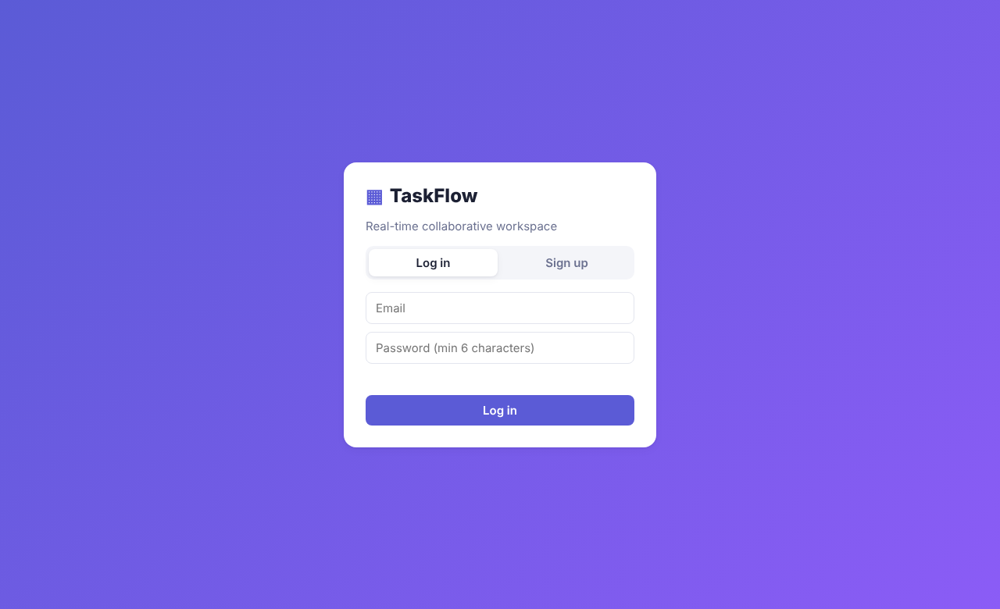
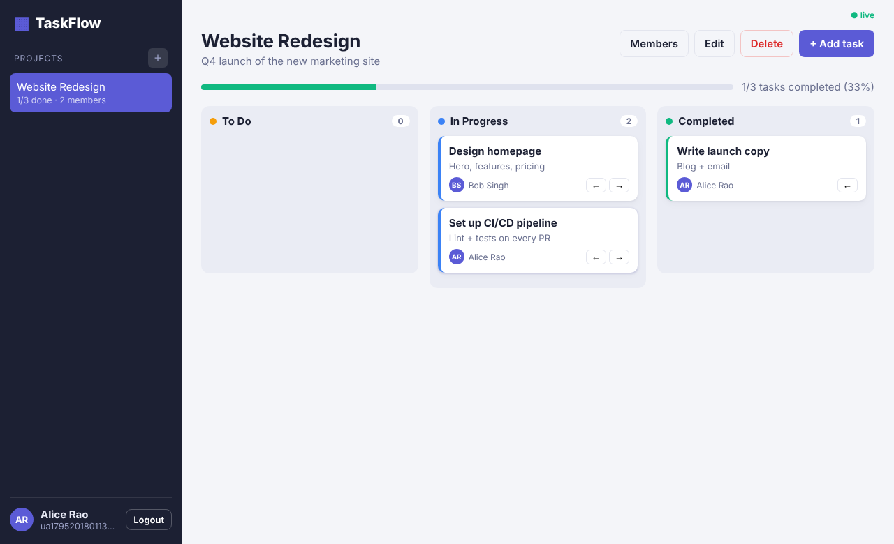
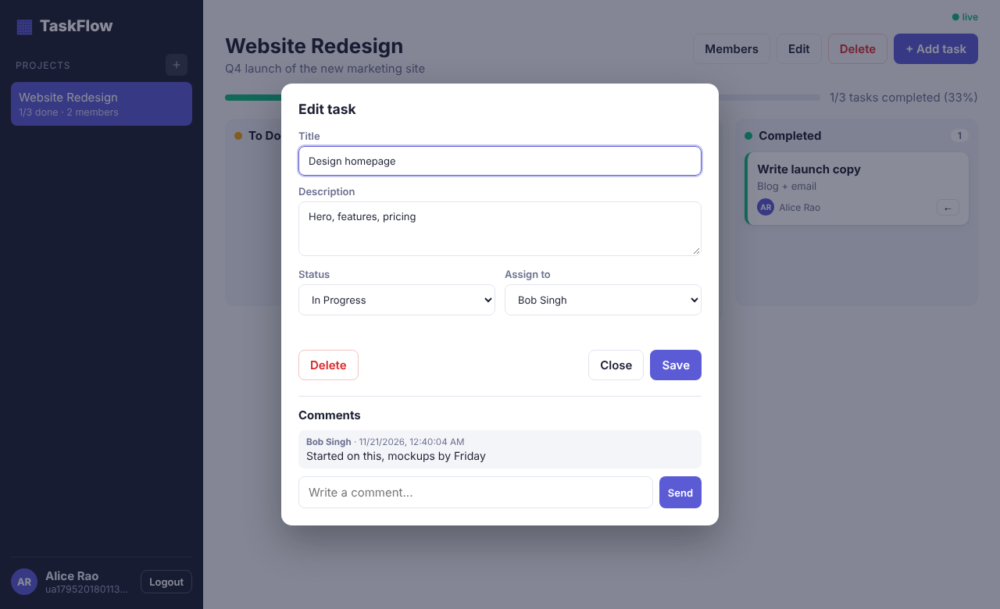
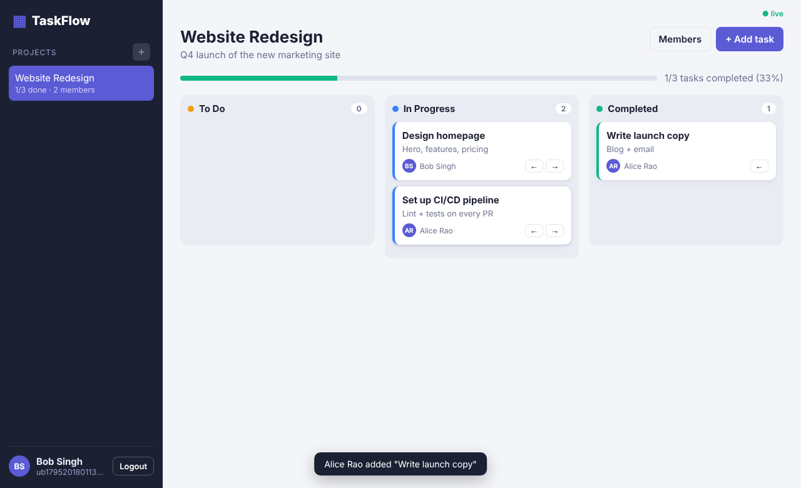
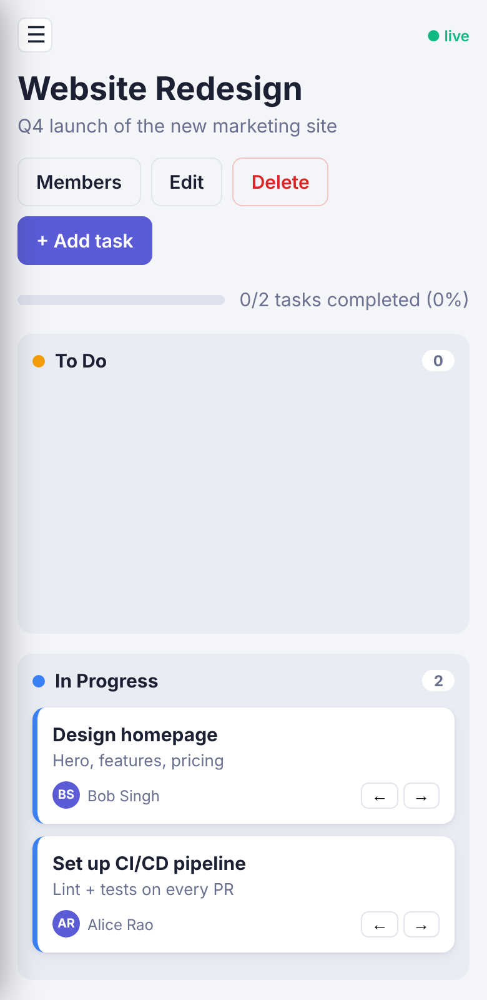

# TaskFlow – Real-Time Collaborative Workspace

A Trello/Asana-style project manager. Teams create projects, organise tasks on a Kanban board, assign them to members, comment on cards, and see every change live without refreshing.

## Features

- **Authentication** – register/login, bcrypt password hashing, JWT sessions, logout
- **Projects** – create, view, edit, delete; add/remove members by email; progress bar per project
- **Kanban board** – To Do / In Progress / Completed columns; create, edit, delete and assign tasks; drag-and-drop or ← → buttons to move cards
- **Real-time collaboration (Socket.IO)** – new tasks, edits, moves, deletions, comments, and membership changes appear instantly for everyone connected to the project
- **Comments** – threaded per task, delivered live
- **Responsive UI** – sidebar navigation, modal forms, colour-coded status, mobile drawer menu
- **Security basics** – JWT-protected REST routes and sockets, membership checks on every project/task/comment operation, only owners can edit/delete a project, HTML-escaped output

## Tech stack

HTML5 / CSS3 / vanilla JavaScript · Node.js + Express · MongoDB (Mongoose) · Socket.IO · JWT + bcryptjs

## Project structure

```
taskflow/
├── frontend/
│   ├── index.html
│   ├── css/style.css
│   └── js/app.js
└── backend/
    ├── server.js
    ├── config/        db.js, socket.js
    ├── models/        User, Project, Task, Comment
    ├── controllers/   auth, project, task (incl. comments)
    ├── routes/        auth, projects, tasks
    └── middleware/    auth.js (JWT guard, async wrapper)
```

## Setup

**Prerequisites:** Node.js 18+ and MongoDB (local install, or a free MongoDB Atlas cluster).

```bash
cd backend
npm install
cp .env.example .env      # then edit JWT_SECRET (and MONGO_URI if not local)
npm start                 # or: npm run dev
```

Open **http://localhost:5000**. The Express server also serves the frontend.

### Try the real-time features

1. Register two users (use a normal window and a private/incognito window).
2. User A creates a project and adds User B via **Members** (by email).
3. Both open the project. Add, drag, edit, or comment on a task in one window and watch the other update instantly.

## Environment variables

| Name | Description | Default |
|---|---|---|
| `PORT` | Server port | `5000` |
| `MONGO_URI` | MongoDB connection string | `mongodb://127.0.0.1:27017/taskflow` |
| `JWT_SECRET` | Secret for signing tokens (required) | – |
| `JWT_EXPIRES_IN` | Token lifetime | `7d` |

## REST API

All routes except register/login require `Authorization: Bearer <token>`.

| Method | Route | Purpose |
|---|---|---|
| POST | `/api/auth/register` | Create account |
| POST | `/api/auth/login` | Log in |
| GET | `/api/auth/me` | Current user |
| POST | `/api/auth/logout` | Log out (client discards token) |
| GET/POST | `/api/projects` | List / create projects |
| GET/PUT/DELETE | `/api/projects/:id` | View / edit / delete (edit & delete: owner only) |
| POST | `/api/projects/:id/members` | Add member `{ email }` |
| DELETE | `/api/projects/:id/members/:userId` | Remove member (or leave) |
| GET/POST | `/api/projects/:projectId/tasks` | List / create tasks |
| PUT/DELETE | `/api/tasks/:id` | Edit/move / delete task |
| GET/POST | `/api/tasks/:id/comments` | List / add comments |

## Socket.IO events

Clients authenticate with the JWT (`io({ auth: { token } })`) and emit `project:join` with a project id. Server → client events: `task:created`, `task:updated`, `task:deleted`, `comment:created`, `project:updated`, `project:deleted`, `project:added`, `project:removed`.

## Database schema

- **User** – name, email (unique), password (bcrypt hash)
- **Project** – name, description, owner, members[]
- **Task** – title, description, status (`todo` | `in-progress` | `completed`), assignedTo, project, createdBy
- **Comment** – task, user, text, createdAt

## Screenshots

| | |
|---|---|
| Login / sign up |  |
| Kanban board |  |
| Task modal with live comments |  |
| Second user's window (updated live) |  |
| Mobile layout |  |

## Publishing to GitHub

```bash
git init && git add . && git commit -m "TaskFlow initial commit"
git branch -M main
git remote add origin https://github.com/<your-username>/taskflow.git
git push -u origin main
```
